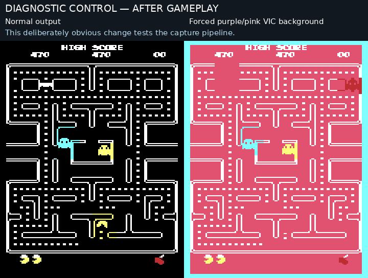

# Comparison capture audit

Prepared 2026-11-03 after the user reported that the comparison videos looked
identical and questioned whether they contained the intended experimental builds.
No renderer or gameplay code was changed during this audit.

## Findings

The seven saved comparison files contain different left/right footage. Each
half matches its intended separately saved source recording, allowing for the
small differences from re-encoding H.264. The files checked cover the first
flicker reduction, region compositor, sprite kernels, Pac-Man raster gate,
ghost precomposition, temporary character copies and beam scheduling.

Every comparison contains 600 decoded frames. Between about 0.77% and 1.12%
of pixels differ substantially between sides on an average frame, using a
24/255 per-channel difference threshold. Most of the screen is the unchanged
maze. **Different pixels do not establish reduced flicker.** The detailed
[decoded-video audit](../build/capture-audit/existing-videos.json) includes
source paths, hashes and matching errors.

For stronger evidence, fresh captures saved immutable PRG/label copies, stopped
VICE before platform startup, and compared all **33,792 depacked program bytes**
against an independently executed PRG loader. The loaded images also match
the corresponding compiled native binaries. The original, shadow and beam
builds each match their own image and have different program hashes.

During those fresh captures, the shadow entry point executed 125 times. The
beam build's protected-group counter advanced by 293, and its normal-frame
counter advanced by 68. This verifies that the experimental paths ran during
the recorded gameplay, beyond checking a filename or PRG hash.

## A measurement/reporting problem

The FPS figures previously presented with the comparisons came from separate
native scene benchmarks. **They were not measurements of the gameplay in
those videos.** The opening benchmark supplies no continuing joystick turns;
the recordings use a computer-controlled route that keeps eating pellets.
The workloads and sampled periods differ.

Non-stopping VICE checkpoints now count completed renderer calls during the
actual recording. In the fresh six-second segment:

| Executable | Completed renderer calls/s | Program SHA-256 prefix |
| --- | ---: | --- |
| Accepted original | 33.42 | `8e62f44052d2` |
| Temporary character copies | 20.82 | `1aead2a2d0d4` |
| Beam scheduling | 23.51 | `e8a7ae03f685` |

These are completed renderer calls, not counts of unique movement poses. The
video capture cadence remains approximately 60.28 frames/s in every case,
and gameplay retains its original clock. The earlier 51.93/33.51/32.57 opening
benchmark results remain genuine measurements of that benchmark; presenting
them as the rates experienced in the comparison playthroughs was misleading.
The active beam sample is below the user's 30 FPS play-test threshold.

The fresh recordings and per-frame counters have individual manifests for
the [original](../build/capture-audit/verified-beam/before/recording.json),
[beam build](../build/capture-audit/verified-beam/after/recording.json) and
[shadow build](../build/capture-audit/verified-shadow/recording.json).
Existing published comparison artifacts were preserved.

## Making the displayed artifact identifiable

All previous comparisons used the basename `comparison.mp4`. Local file
checks cannot establish which preview a client displayed. The new diagnostic
has a unique basename and prominent build/hash labels:

[Open the capture audit](../build/capture-audit/vic20-capture-audit-original-8e62f440-beam-e8a7ae03.mp4).

Its gameplay portion is unmodified. It ends with a separate, clearly labelled
diagnostic: after recording, the VIC background is deliberately forced to
purple/pink. That change affects over 41,000 of the 55,680 captured pixels,
confirming that the capture responds to actual display changes. **The colour
control is synthetic and is not an optimization or flicker comparison.**



The monitor's display-get implementation reads the raster drawing buffer;
it does not reconstruct the game's final bitmap from RAM. This follows
[VICE's display-get code](https://github.com/VICE-Team/svn-mirror/blob/main/vice/src/monitor/monitor_binary.c)
and [raster screenshot buffer setup](https://github.com/VICE-Team/svn-mirror/blob/main/vice/src/raster/raster.c).
The deliberately changed display was also checked through the installed VICE.

## Decision

The recordings checked here are not duplicate footage, and the fresh runtime
checks confirm that the experimental programs execute. The user's report of
no perceptible benefit still stands. Neither the temporary-character nor the
beam experiment is accepted as an improvement. The accepted original stays
unchanged. No visible flicker reduction is claimed from byte comparisons,
pixel differences or scheduling coverage.

Future comparisons need program identity, actual-capture rendering rates and
a direct evaluation of disappearing actors and colour changes. The present
timing checks alone do not answer the perceptual question.

```sh
python3 tools/arcade/audit_comparisons.py
python3 tools/arcade/record_shadow.py --after build/pacman-beam.prg --output build/capture-audit/new-beam --frames 360 --audit
```

The original PRG remains SHA-256
`8e62f44052d280cf63674878c362ba72493d8e5aeba55363913e5cc5cf99b621`.
