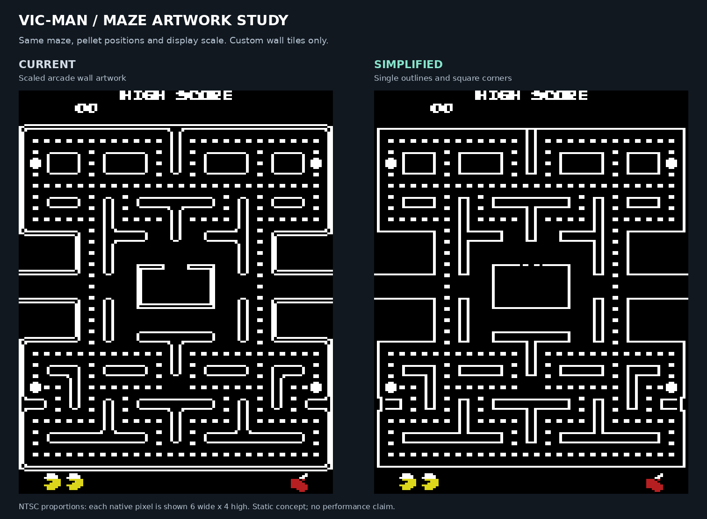

# Simplified maze artwork study

Follow-up: the [VIC-native multicolour prototype](MULTICOLOUR_PROTOTYPE.md)
now explores blue walls with white pellets, a wider layout, custom actors and
hires score digits. Its separate static PRG is verified in NTSC VICE; the
playable game remains unchanged.

This is an offline visual mockup of the original maze with custom VIC-20 wall
artwork. It keeps the current 112×216 display geometry and all 240 regular
pellets and four power pellets in their original locations. The logical board,
gameplay code, actor graphics and executable are unchanged.



[Open the interactive comparison](artwork/maze-mockup.html) to toggle pellets,
the current actors and the hardware character grid. The standalone
[simplified maze](artwork/maze-simplified-ntsc.png) and
[current maze](artwork/maze-current-ntsc.png) use the same NTSC proportions.
Each native pixel is enlarged six pixels horizontally and four vertically;
no smoothing is applied. These are generated artwork previews, not emulator
captures.

## Artwork choices

The simplified version replaces doubled outer/house borders with one outline,
uses square corners and consistent one-pixel strokes, and reuses the same
uprights for outer and inner walls. A short dashed line identifies the existing
ghost-house doorway. That marker is cosmetic; entrance rules remain in the
arcade logic. White walls and white standing pellets are retained.

Only wall masks change. The original logical tile codes and every corridor,
intersection, tunnel and pellet tile stay in place. The authoring data contains
six rows of four hires pixels per tile, making each proposed shape inspectable
in [maze-wall-tiles.json](artwork/maze-wall-tiles.json). Several logical wall
codes intentionally share the same shape.

The optional actor view uses the existing actor masks, positions, priority and
colour-cell ownership from the full-board fixture. A ghost or Pac-Man can
temporarily tint a shared wall/pellet cell, as in the current renderer. It is a
static check of scale and sharing, not evidence of reduced flicker. Score
readability remains a separate queued improvement.

## Character-memory findings

Counts use exact byte patterns at the current hardware geometry: 14×14 cells,
each 8×16 pixels. The eight blank storage scanlines below the visible picture
are included. Actors are excluded from these background counts.

| Measure | Current artwork | Simplified artwork |
| --- | ---: | ---: |
| Distinct 4×6 wall masks used by the board | 33 | 20 |
| Distinct 8×16 patterns, all pellets present | 118 | 109 |
| Distinct 8×16 patterns, all pellets eaten | 101 | 92 |
| Union of all local pellet present/absent combinations, with a fixed HUD | 413 | 382 |
| Background slots with private pellet/HUD cells and shared fixed cells | 176 | 173 |
| Corresponding background bytes | 2,816 | 2,768 |
| Potential bytes released from the current 3,136-byte bitmap | 320 | 368 |

Simpler artwork reduces repetition costs, but **it does not yet establish a
workable buffered actor renderer**. At this scale, 4×6 logical tiles span 8×16
hardware cells at several vertical phases. Pellets in the same hardware cell
can disappear independently. Sharing a pattern must not make another pellet or
wall change with it.

The last three rows use a deliberately simple allocation model: give each
cell containing a pellet, or touching the existing top/bottom HUD, its own
writable character. Share the remaining fixed patterns. There are 116 pellet
cells, 42 HUD cells, and 144 cells in their union. The simplified fixed cells
then require another 29 patterns. This background-only model releases 23
characters, or 368 bytes, compared with today's unique-cell bitmap. The
artwork's additional saving over sharing the current maze is three characters,
or 48 bytes.

For comparison, two sets of four work characters for each of four ghosts
require 32 characters, or 512 bytes. That exceeds the 23 released here, before
Pac-Man, fruit, messages, overlap handling and renderer metadata. The separate
software-stack and virtual-I/O reservations have not been reclaimed or counted
as free memory. The 382-pattern union is a set of possible local states, not
a requirement to hold all of them simultaneously; storing every possibility
in a single 256-character set would not fit.

The result supports reviewing the cleaner artwork on its visual merits. A
larger memory gain needs a separate allocation study, such as a reusable HUD
font and a better scheme for changing pellet cells. This mockup does not claim
an FPS or flicker improvement and changes no runtime allocation.

## Blue walls with white pellets

The follow-up colour study tests the request for a blue maze while retaining
white standing pellets. The [comparison](artwork/maze-blue-comparison.png)
shows two hardware-valid palette choices at the current hires resolution:
white-pellet priority on the left and blue-wall priority on the right. Both
use the exact same simplified wall and pellet masks; actors are omitted.

The simplified maze has visible wall pixels in 158 hardware colour cells.
Pellet pixels occupy 116 cells, **all of which also contain wall pixels**.
Consequently, making all those walls blue also makes all 240 regular pellets
and all four power pellets blue, even with no actor nearby. Keeping pellets
white leaves their shared walls white. Only the other 42 wall cells can be
blue: 696 of the maze's 2,234 wall pixels, about 31%.

This rules out a complete return to blue through a palette change alone while
meeting the white-pellet requirement. Sharing or buffering character patterns
does not change the per-cell foreground-colour rule. The dashed house door is
included in the wall mask. Scores/status may also share a blue wall cell in
the wall-priority illustration; the image applies one colour to every lit
pixel in that cell rather than selectively recolouring the walls.

Blue walls remain a presentation goal for a further graphics-layout study.
A multicolour layout could assign black, blue and white to the three shared
colours, leaving the cell colour for an actor. That route uses double-width
pixels, so actor readability and the full display-memory budget need their
own prototype. An alternative hires design would have to place white pellet
pixels and blue wall pixels in separate hardware colour cells throughout the
maze. Neither arrangement is established by this first mockup. The playable
game and the primary comparison retain the accepted white maze.

## Reproduce and verify

The generator reads the original-arcade full-board fixture produced by
`tests/arcade.py`, the current generated tile masks, and the authored wall
definitions. With the existing build/fixtures available:

```sh
python3 tools/arcade/maze_mockup.py
```

It writes the comparison, native pixel images, NTSC previews, an interactive
HTML viewer, the [hardware pattern sheet](artwork/maze-character-patterns.png),
the blue-maze palette comparison, and
[counts with input hashes](artwork/maze-character-analysis.json). It asserts
that the complete board has 240 regular/four power pellets, every wall code is
covered, and all non-wall masks remain identical. It exhausts every combination
of the pellet fragments in each hardware cell.

An independent check loaded the same full board into the accepted native 6502
build and rebuilt its background: all 3,136 current-background bytes matched
the generator, as did all 196 colour cells. The game PRG remains SHA-256
`8e62f44052d280cf63674878c362ba72493d8e5aeba55363913e5cc5cf99b621`.
