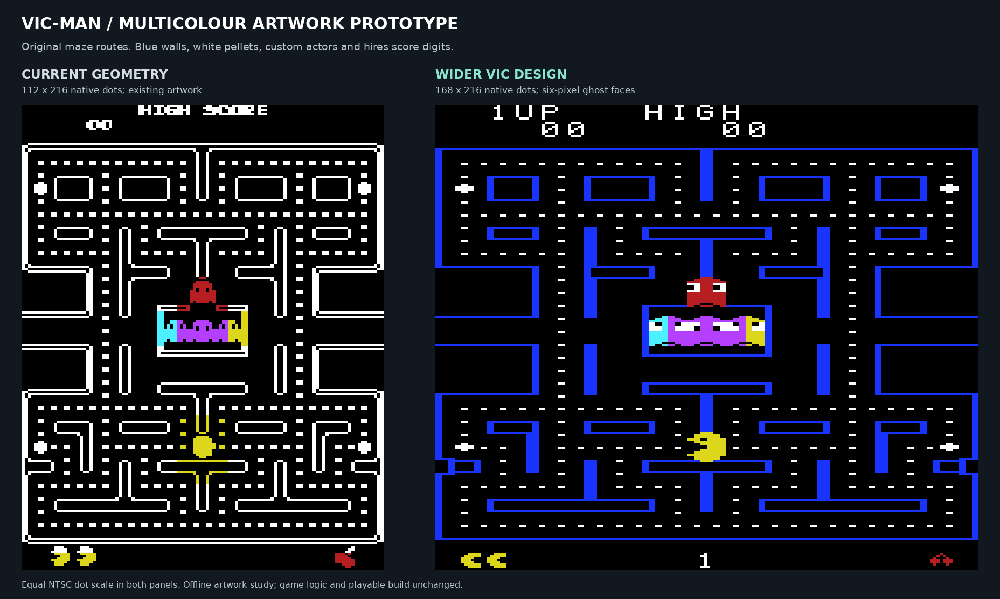

# VIC-native multicolour artwork prototype

A subsequent [live integration](MULTICOLOUR_GAME.md) now connects this design
to the real game and sound. This document preserves the original visual study
and its memory analysis.

This isolated prototype draws the original maze routes with blue walls, white
pellets, custom actors and readable hires score digits. It uses a wider
168×216-dot presentation. The playable Pac-Man sources and PRG are unchanged.

The user has accepted this visual direction. A separate
[moving-character implementation](MULTICOLOUR_MOTION.md) now verifies the
hidden preparation mechanism and provides a real VICE recording. A retained
[character-band optimization](MULTICOLOUR_PREPARATION.md) reduces preparation
time by 17.39%; further performance work is needed before game integration.



[Open the interactive comparison](artwork/multicolour/index.html),
[view the proposed screen at NTSC proportions](artwork/multicolour/normal-ntsc.png),
or inspect the [actor and digit sheet](artwork/multicolour/actors-and-digits.png).
The viewer includes maze-only, frightened, deliberate overlap and full-width
score examples, with pellet and hardware-grid toggles.

## Presentation

The maze has the same 28-column logical layout, intersections, tunnel, house
and all 240 regular/four power-pellet locations. Each logical tile becomes
three multicolour pixels wide and six scanlines high. Pellet artwork is drawn
specifically for this grid. The existing hand-authored single-outline wall
pieces are simplified to this width; the generated
[3×6 tiles](artwork/multicolour/maze-tiles.json) expose every resulting mask.

The picture is 50% wider than the current display at the same NTSC dot scale.
Its multicolour playfield has **84 independent horizontal pixels** across
168 native dots, compared with the current 112 hires pixels. The wider layout
allows six-column ghost faces rather than the four columns of a same-width
multicolour conversion. Those six columns still contain less horizontal
detail than today's eight-column hires actors. The artwork needs visual review
on that basis, rather than treating 168 dots as 168 independent playfield pixels.

Ghosts and Pac-Man are six multicolour pixels by fourteen scanlines, centred
one scanline above/below the current twelve-line actor footprint. The ghosts
have two distinct eyes, directional pupils, two foot poses and a separate
frightened face. Pac-Man has purpose-drawn elliptical silhouettes and mouth
phases. Original arcade orientation and position data place the actors in the
starting-position view; the frightened/overlap views are illustrations, not
claims that those states occurred in the fixture.

The top two character rows and bottom status row remain hires. Each digit is
a hand-authored 5×7 shape in its own 8×8 character. This gives score digits
consistent spacing and distinguishes 3/8/9 and 5/6. Player/high-score values
come from the original fixture's BCD bytes, with the original six positions
and four-leading-blank limit. The full-width example deliberately substitutes
sample numbers and a second-player label to review all digit shapes. Gameplay
score calculations and formatting code have not been modified.

## Colours and actual VIC verification

| Bit pair | Source | Use |
| --- | --- | --- |
| `00` | Black global background | Empty playfield and opaque pupil pixels |
| `01` | Blue global border colour | Maze walls and frightened bodies |
| `10` | Per-cell foreground | Normal actor body colour |
| `11` | White global auxiliary colour | Pellets, eyes and frightened faces |

Changing an actor's cell accent cannot recolour blue or white pixels. An
actor may cover a pellet, and two normal actors sharing a cell can still
share body colour. The starting-position scene has four such cells; the
deliberate overlap illustration has six. This is a narrower colour clash,
not a guarantee of independent colours for every actor pixel.

The bit-pair mapping follows [VICE's VIC drawing implementation](https://raw.githubusercontent.com/VICE-Team/svn-mirror/main/vice/src/vic20/vic-draw.c).
Its [matrix/colour fetch implementation](https://raw.githubusercontent.com/VICE-Team/svn-mirror/main/vice/src/vic20/vic-cycle.c)
also confirms the address relationship across the two halves of colour RAM.
The prototype independently checks both with the installed NTSC VICE:

- The standalone PRG boots and configures mixed hires/multicolour characters.
- All **36,288 native picture pixels** match the predicted artwork exactly
  using VICE's own palette, including the hires HUD and all three global/one
  local colour sources.
- All 567 screen codes and 567 colour nibbles match the generated data.
- A 960-byte canary covering the existing virtual-I/O and software-stack
  reservations survives the display initialization.

See the [actual cropped VICE image](artwork/multicolour/vice-artwork-ntsc.png),
[full VICE screen](artwork/multicolour/vice-screen.png), and
[verification record](artwork/multicolour/vice-validation.json).
The blue palette also makes the outer border blue. The artwork comparisons
crop to the picture; the full capture includes that border. A black border
would require a separately evaluated raster technique. Physical hardware has
not been tested.

White auxiliary colour occupies the upper nibble of `$900E`. An integrated
audio driver must preserve it when changing volume; the current driver clears
that nibble. The standalone display is silent and does not call that driver.

## Character and memory budget

This uses ordinary VIC-visible internal RAM and the existing conventional
expansion arrangement. It introduces no exotic memory expansion. Eight-line
characters allow a 256-slot, 2 KB character set. The screen matrix moves into
internal RAM and uses 567 bytes for 21×27 cells.

| Internal RAM | Bytes | Prototype use |
| --- | ---: | --- |
| `$1000–$17FF` | 2,048 | 256 character slots |
| `$1800–$1A36` | 567 | Screen matrix |
| `$1A37–$1C3F` | 521 | Available for future renderer metadata |
| `$1C40–$1D3F` | 256 | Existing virtual-I/O reservation retained |
| `$1D40–$1FFF` | 704 | Existing software-stack reservation retained |

Colour RAM is `$9400–$9636`; its last 55 entries cross the old 512-byte page
boundary. VICE validates those entries and their displayed pixels. The static
PRG executes its copy loop from expansion RAM at `$2000`, so loading character
data cannot overwrite executing code. It does not alter the game linker map.

The analysis considers **every local present/absent combination** of pellets
within each character cell, including power-pellet fragments crossing cells.
It finds 146 maze character patterns across all those possibilities. All ten
digits, the five letters needed for `1UP`/`HIGH`, and the life/fruit status
icons add 17 more. Reserving all **163 patterns** takes 1,304 bytes and leaves
**93 working slots / 744 bytes** for actors in the 256-slot set. These are
graphics slots, separate from the 521-byte metadata gap above.

A background cache can improve that budget because not all 146 maze variants
can appear at once. An exact cell-to-pattern matching calculation, checked by
an equal-size vertex cover that covers every allowed choice, bounds the maze
plus all HUD glyphs at **147 simultaneously distinct patterns**. This leaves
**109 working slots** if unused background variants are loaded on demand.
The bound allows independent fragment choices, so actual coupling between
power-pellet fragments cannot make it larger.

A six-column by fourteen-line actor can touch up to three character columns
and three rows: nine cells. Reserving nine private characters for each of six
actors, for both old and prepared images, requires 108 slots. The demand-loaded
bound therefore leaves **one slot** beyond that deliberately conservative
footprint calculation. The 93-slot fully preloaded version does not meet that
108-slot bound.

This is enough to justify investigating a moving-actor renderer without
shrinking the faces further. It is not a complete implementation budget:
reference counts, background ownership, pending screen/colour changes,
allocation order, actor overlap, messages and intermissions still need design
and cycle measurements. The static PRG uses only the patterns in its single
visible scene; it does not implement that background cache or actor buffering.

Full counts, input hashes, region limits and prototype PRG hash are in
[analysis.json](artwork/multicolour/analysis.json).

## Run and reproduce

With the existing build, original full-board test fixture and ca65 tools:

```sh
python3 tools/arcade/multicolour_mockup.py
python3 tools/arcade/check_multicolour.py
bash build/multicolour/run.sh
```

The first command generates the artwork, character analysis, raw data and
`build/multicolour/display.prg`. The second boots that separate PRG in VICE
and compares actual pixels. The last opens the static display for review.
There is no gameplay input or animation in this PRG. Closing the emulator
returns to the normal workflow; `make run` continues to run the accepted game.

No game logic, clock, ghost patterns, movement, collision, sound sequencing or
playable renderer has changed. Static artwork cannot demonstrate faster frames
or less flicker. The [moving-actor experiment](MULTICOLOUR_MOTION.md) records the
subsequent implementation and its current performance limit.
